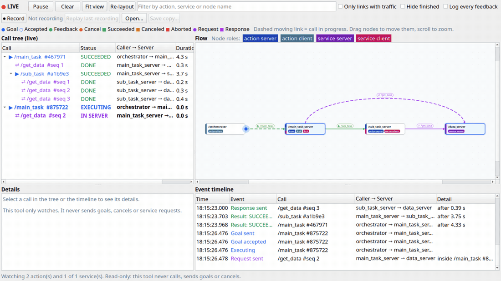
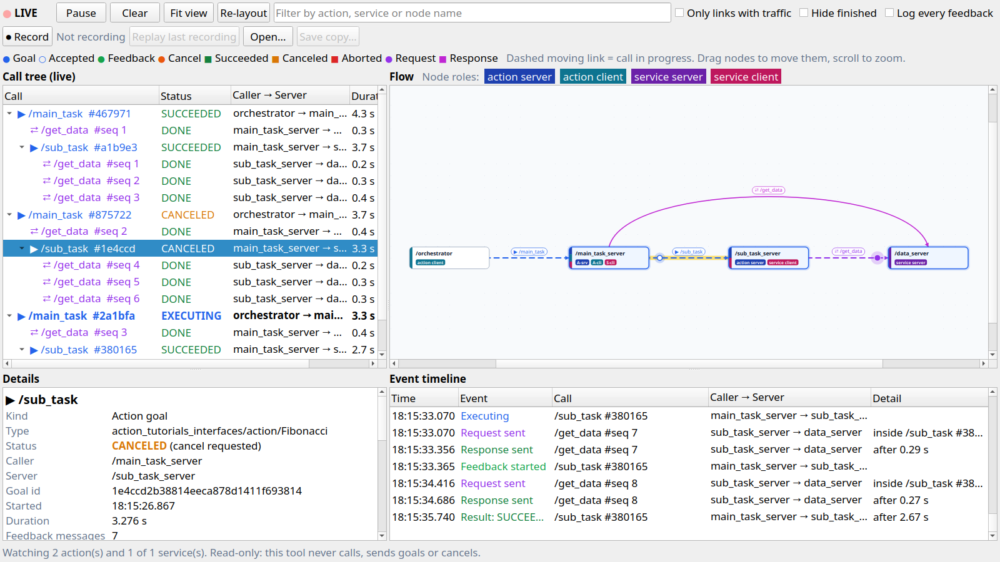
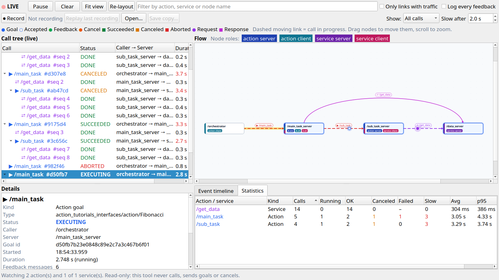

# rqt_execution_flow

**See what your ROS 2 system is *doing*, not just how it is wired.**

An rqt plugin that shows ROS 2 action goals and service calls live: who called whom,
which call triggered which, and how each one is progressing. Goals, feedback,
cancels, results, requests and responses move between nodes as animated packets,
like a network monitor.




## Why

`rqt_graph` shows which nodes are connected. When an orchestrator calls an action,
that action calls another action, and that one calls a service, `rqt_graph` can't
tell you which call is running right now, which one is waiting, or why a goal was
canceled.

`rqt_execution_flow` answers those questions:

```
/main_task  #5e81cf  CANCELED   orchestrator -> main_task_server     3.7 s
├── /get_data  #seq 2  DONE     main_task_server -> data_server      0.4 s
└── /sub_task  #0e88ea CANCELED main_task_server -> sub_task_server  3.3 s
    ├── /get_data  #seq 4  DONE sub_task_server -> data_server       0.3 s
    └── /get_data  #seq 5  DONE sub_task_server -> data_server       0.3 s
```

It is **read-only**. It never sends goals, cancels goals or calls services.

> [!IMPORTANT]
> **Actions work out of the box. Service calls need one step from you.**
> ROS 2 Jazzy only reports a service call if the node that serves or makes it has
> turned on **service introspection**. Until you add that one line to your node,
> its service calls won't appear in the plugin. See
> [Making service calls visible](#making-service-calls-visible).

## Features

- **Live call tree.** Action goals and service calls, nested under the call that
  triggered them, with status, caller, server, duration and feedback count.
- **Animated flow view.** Nodes as boxes, actions and services as links. Packets
  travel along the links for every goal, accepted, feedback, cancel, result,
  request and response. Links that are busy show moving dashes, and nodes doing
  work glow.
- **Event timeline.** Every step with a millisecond timestamp.
- **Details panel.** Goal id, status history, latest feedback, service request and
  response data, round-trip time and server processing time.
- **Record and replay.** Record a run, then replay it at 0.1× to 2× speed, step
  through it one event at a time, or jump anywhere with a slider. Recordings are
  saved as files you can share.
- **Slow and stuck calls.** Calls running longer than a limit you set turn red in the
  tree and the flow view.
- **Statistics.** For every action and service: calls, running, succeeded, canceled,
  failed, slow, and average, 95th-percentile and slowest time.
- **Focus and filters.** Click a node to see only its calls. Show only running,
  succeeded, canceled, failed or slow calls.
- **Problem warnings.** Flags node names used by more than one node, which makes
  goals and replies go to the wrong copy, and services whose calls can't be seen.



## Requirements

- ROS 2 **Jazzy** (tested on Ubuntu 24.04)
- `rqt` and `rqt_gui_py`, included in the `ros-jazzy-desktop` install

## Installation

```bash
mkdir -p ~/ros2_ws/src
cd ~/ros2_ws/src
git clone https://github.com/nivednivu1997/rqt_execution_flow.git
cd ~/ros2_ws
source /opt/ros/jazzy/setup.bash
rosdep install --from-paths src --ignore-src -y
colcon build --packages-select rqt_execution_flow
source install/setup.bash
```

## Quick start

Start the included demo system. It has nested actions, a shared service, a
cancel and an abort:

```bash
ros2 run rqt_execution_flow execution_flow_demo
```

In a second terminal, open the plugin:

```bash
source ~/ros2_ws/install/setup.bash
ros2 run rqt_execution_flow rqt_execution_flow
```

It is also available inside rqt under **Plugins → Actions → Execution Flow**. Run
`rqt --force-discover` the first time so rqt finds it.

The demo runs this system on a loop:

```
orchestrator     --/main_task-->  main_task_server
main_task_server --/get_data-->   data_server
main_task_server --/sub_task-->   sub_task_server
sub_task_server  --/get_data-->   data_server
```

## Using the plugin

| Area | What it shows |
|---|---|
| Call tree | Every goal and service call, nested by who triggered it. Running calls are bold. |
| Flow | Nodes and links, with packets moving along them. Drag nodes to move them, scroll to zoom. |
| Event timeline | Each step in order. Click a row to select that call. |
| Details | Everything known about the selected call. |

Packet legend:

| Packet | Meaning | Direction |
|---|---|---|
| Blue dot | Goal sent | caller → server |
| Blue ring | Goal accepted | server → caller |
| Small green dots | Feedback, one per message | server → caller |
| Orange ✕ | Cancel requested | caller → server |
| Green / orange / red square | Result: succeeded / canceled / aborted | server → caller |
| Purple dot | Service request | caller → server |
| Magenta square | Service response | server → caller |

Node colours: each node has a coloured stripe on its left edge and a tag for every
role it plays. A node with several roles gets one stripe band and one tag per role.
When the tags don't fit, they switch to short forms such as `A-srv` and `S-cli`.

| Colour | Role |
|---|---|
| Dark blue | Action server |
| Teal | Action client |
| Purple | Service server |
| Rose | Service client |

Toolbar options: **Filter** by name, **Only links with traffic**, **Log every
feedback**, **Fit view**, **Re-layout**, **Pause** and **Clear**.

### Finding slow or stuck calls

Set **Slow after** (default 5 s). When a call runs longer than that:

- its row in the call tree turns red while it runs
- its link in the flow view turns red
- the timeline adds a `Slow: running over N s` line, once per call

Finished calls that took longer keep a red duration. Changing the limit updates
everything straight away.

### Filtering by result

The **Show** list limits the call tree and the timeline to some calls:

| Choice | Shows |
|---|---|
| All calls | Everything |
| Running | Calls still in progress |
| Succeeded | Goals that succeeded and services that answered |
| Canceled | Canceled goals |
| Failed | Aborted goals |
| Slow | Calls longer than the slow limit |
| Problems | Canceled, failed or slow |

Parent calls stay visible, so you can still see what triggered a matching call.

### Focusing on one node

**Click a node** in the flow view. The call tree and the timeline then show only
calls that node made or served. The node gets an amber border, and unrelated nodes
and links fade. Click the node again, or the `Node: … ✕` chip, to show everything.
Dragging a node moves it without focusing.

### Statistics

The **Statistics** tab, next to the event timeline, has one row per action and
service:

| Column | Meaning |
|---|---|
| Calls | Calls since the plugin started or since **Clear** |
| Running | Calls in progress right now |
| OK, Canceled, Failed | How the calls ended. Services have no failure state. |
| Slow | Finished calls longer than the slow limit |
| Avg, p95, Max | Average, 95th-percentile and slowest duration |

Click a column header to sort, for example by **Max** to find the slowest service.
Double-click a row to filter the call tree by that name. Calls that started before
the plugin was watching are counted, but not timed. Statistics aren't affected by
the filters.



## Record and replay

Things often happen too fast to follow live. To slow them down:

1. Press **Record**. The live view keeps running.
2. Make your system do the thing you want to debug.
3. Press **Stop recording**. The recording is saved and replay mode opens.
4. Press **Play**. The default speed is 0.25×.

In replay mode:

- **Step** goes to the next event only and plays just its animation.
- The **slider** jumps to any moment.
- **Skip quiet time**, on by default, jumps over moments where nothing is running.
- **Open…** loads a recording, for example one made on a robot.
  **Save copy…** saves it somewhere else.
- **Back to live** returns to the live view.

Recordings are saved automatically in
`~/.ros/rqt_execution_flow/recordings/`, or `$ROS_HOME/rqt_execution_flow/recordings/`
if `ROS_HOME` is set. Old recordings are never deleted for you.

## Making service calls visible

What the plugin can see on Jazzy:

| Traffic | Needs a change in your nodes? |
|---|---|
| Action goal status: accepted, executing, canceling, succeeded, canceled, aborted | No |
| Action feedback, with its content | No |
| **Service calls** | **Yes: turn on service introspection, one line per node** |

ROS 2 Jazzy only reports a service call when the node turns on **service
introspection**. It is off by default, and Jazzy has no parameter or environment
variable to turn it on. It has to be done in code.

### If you skip this step

- The node's service calls **never appear** in the call tree, flow view or timeline.
- The service's link is drawn **dotted** and labelled `(introspection off)`.
- A warning at the top says how many services can't be seen. Hover over it for
  the list.

Actions are not affected. They show up either way.

### Python nodes

With this package installed, call the helper once, **after** creating your clients
and services. It turns introspection on for all of them:

```python
from rqt_execution_flow.introspection import enable_service_introspection

enable_service_introspection(node)
```

Without depending on this package, use plain rclpy on each client or service:

```python
from rclpy.qos import qos_profile_system_default
from rclpy.service_introspection import ServiceIntrospectionState

my_service.configure_introspection(
    node.get_clock(), qos_profile_system_default, ServiceIntrospectionState.CONTENTS)
```

### C++ nodes

Call this on each service and each client, after creating it:

```cpp
#include "rcl/service_introspection.h"

my_service->configure_introspection(
    get_clock(), rclcpp::SystemDefaultsQoS(),
    RCL_SERVICE_INTROSPECTION_CONTENTS);

my_client->configure_introspection(
    get_clock(), rclcpp::SystemDefaultsQoS(),
    RCL_SERVICE_INTROSPECTION_CONTENTS);
```

### Which end to turn it on

Turning it on at **one end** is enough for the call to appear. Both ends give the
most detail.

| Turned on at | Call shown? | Caller identified | Steps seen | Timing |
|---|---|---|---|---|
| Server only | Yes | Exactly | received, responded | Server processing time |
| Caller only | Yes | Exactly | sent, response received | Round-trip time |
| Both | Yes | Exactly | all four | Both |
| Neither | **No** | | | |

Turning it on at the **server** covers every caller of that service, including
nodes you don't control and `ros2 service call` from a terminal.

### Full data or timing only

- `CONTENTS` (used above) also shows the request and response data in the details
  panel.
- `METADATA` shows the call and its timing without the data. Use it for large or
  private data. In Python that's `ServiceIntrospectionState.METADATA`, in C++
  `RCL_SERVICE_INTROSPECTION_METADATA`.

Introspection adds one hidden topic per service, `<service>/_service_event`. With
`CONTENTS`, each request and response is also copied onto that topic.

## How callers and nesting are found

- **Service callers are exact.** Each service event carries an id of the calling
  client, which the plugin matches to the node that owns it.
- **Action callers come from the ROS graph.** If one node can send goals to an
  action, it is the caller. If several can, the plugin picks the one that is busy
  and says it guessed. Watchers such as `ros2 action echo` or other copies of
  this plugin are ignored.
- **Nesting is inferred.** ROS 2 Jazzy doesn't record which goal caused which
  call. The rule: if the caller of a new call is currently executing a goal, that
  goal is the parent. This matches the usual pattern of an action server calling
  other actions and services while it executes.

The details panel always says how a caller or parent was found.

Event times are taken from when each message was **sent**, so durations stay
correct even if messages arrive late. If the machines' clocks differ by more than
5 seconds, arrival time is used instead.

## Limitations

- The goal request and result data aren't visible. Only status and feedback are.
  Action introspection, which would expose them, arrived after Jazzy.
- A cancel request that the server rejects isn't visible. Only accepted cancels
  are, shown as `CANCELING`.
- Nesting is inferred. If one node runs two goals at once and makes calls, the
  newest running goal is chosen as the parent.
- Calls that started before the plugin was watching show `?` as their duration.

## Troubleshooting

**Feedback or service calls for my own interfaces don't appear.**
Source your workspace before starting rqt, so the plugin can load your action and
service types.

**A red warning says a node name is used by more than one node.**
A program was probably started twice. Goals and replies then go to the wrong
copy, and calls can hang. Stop the extra copy.

**A service link says "introspection off".**
Turn on service introspection in that service's server or callers. See
[Making service calls visible](#making-service-calls-visible).

## Project layout

```
rqt_execution_flow/
├── monitor.py        # ROS side: discovers actions and services, subscribes to hidden topics
├── tracker.py        # turns raw events into calls, works out who called whom, statistics
├── schedule.py       # orders animated packets so causes always come before effects
├── recorder.py       # recording, playback and file format
├── flow_widget.py    # main window: call tree, timeline, statistics, filters, record/replay
├── flow_scene.py     # animated flow view, node roles and focus
├── introspection.py  # helper to enable service introspection in your nodes
├── plugin.py         # rqt plugin entry point
├── main.py           # standalone entry point
└── demo.py           # demo system
```

`tracker.py`, `schedule.py` and `recorder.py` have no ROS or Qt imports and are unit
tested.

## Running the tests

```bash
cd ~/ros2_ws/src/rqt_execution_flow
python3 -m pytest test
```

## Contributing

Bug reports and pull requests are welcome. For a bug, a short recording made with
**Record** helps a lot. Attach the `.flowrec.json` file to the issue.

## License

[Apache License 2.0](LICENSE)
